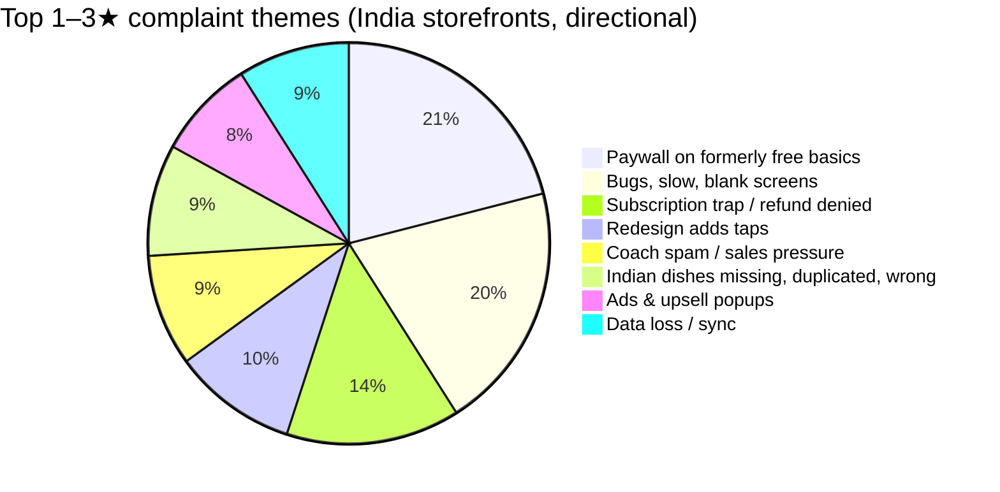
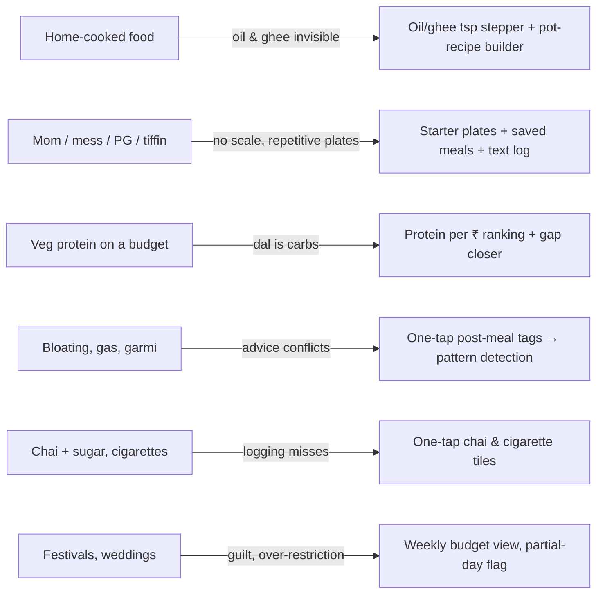

# Why ShredLog is built the way it is — research summary (Nov 2026)

Five parallel research passes: competitor feature audit, Reddit (r/indianfitness, ~16k posts via archive), India Play Store / App Store reviews (~1k per app), Quora / YouTube / Indian blogs, and symptom-journal + progression-engine design studies.

## What makes Indians quit fitness apps

## The Indian-specific gaps nobody serves well

## Rules we adopted

| Area | Rule (source) |
|---|---|
| Pricing | Free forever, no ads, no account, offline. Export/import JSON. (App-store #1, #3, #10) |
| Food DB | One canonical entry per dish, Hindi + English keywords, katori/roti/cup/glass units, half portions, oil stepper. (Reddit #1–2, App-store #8–9) |
| Targets | Mifflin-St Jeor start → adaptive burn from intake + weight trend (7,700 kcal/kg), partial days excluded. (MacroFactor audit) |
| Lifting | Ghost previous sets, auto rest timer with `endAt`, PR badges, double progression (+2.5 kg at top of range), stall after 3 flat sessions, deload after 5–6 hard weeks or low energy/sleep, 10–16 hard sets per muscle. (Hevy/Strong/Boostcamp/RP/Fitbod audit) |
| Feelings | 12 symptoms, explicit "all good" zeros, lag windows per symptom, 2×2 relative risk with permutation test, gates (a≥3, exposures≥5, 14 covered days, RR≥1.75), wording "pattern, not diagnosis", red-flag banner. (Bearable/WHOOP/mySymptoms/Clevers 2024) |
| Micros | ICMR-NIN 2020 RDAs for iron, calcium, D, B12, C, zinc, magnesium, potassium, folate, sodium; India prevalence: D 61%, iron 54%, B12 53% (meta-analysis). Tea-near-iron-meal nudge. |
| Budget | ₹ per 10 g protein from 2025–26 retail prices; soya chunks, dal, eggs, milk, curd cheapest; whey ≈ ₹4/g. |

## iOS PWA facts that shaped the build
- Home-screen web apps have separate storage from Safari → tell users to use the icon only.
- Storage can be evicted; `navigator.storage.persist()` is unreliable → export reminder in Settings.
- No install prompt API → our own "Share → Add to Home Screen" hint.
- Web Push needs a server → no reminders in v1.
